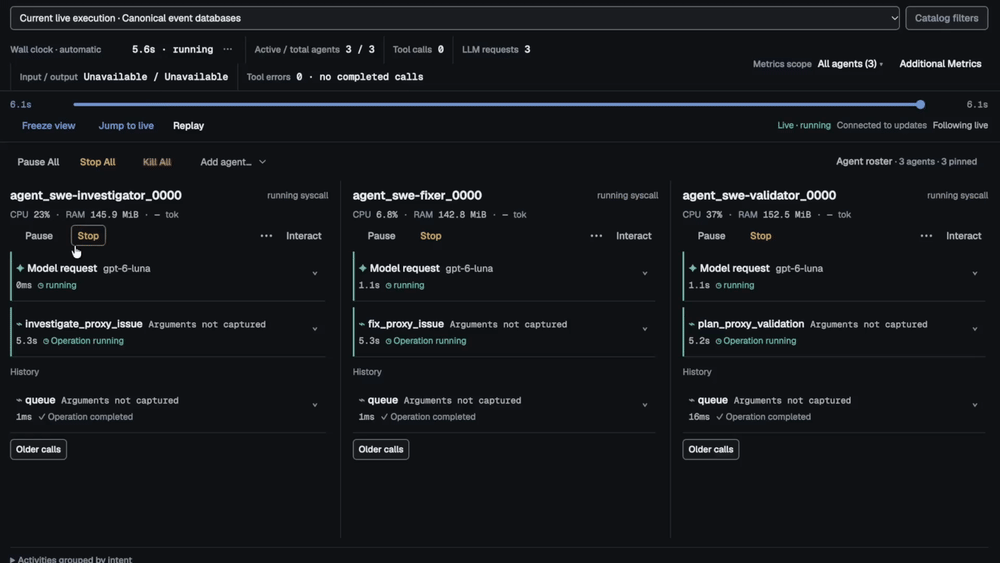
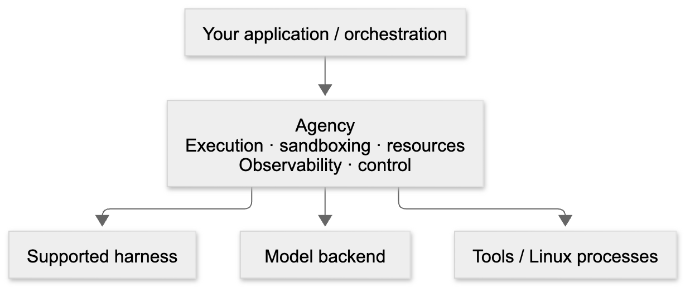

 <div align="center">

<picture>
  <source media="(prefers-color-scheme: dark)" srcset="docs/assets/agency_light.png">
  <source media="(prefers-color-scheme: light)" srcset="docs/assets/agency_wide.png">
  
</picture>

Live debugging and systems profiling for AI agents.

[Getting Started](docs/getting-started.md) · [Documentation](docs/api/index.md) · [Examples](examples/README.md) · [Contributing](CONTRIBUTING.md)

Developed at [UC Berkeley Sky Computing Lab](https://sky.cs.berkeley.edu/)

</div>

Agency is an open-source platform developed at [UC Berkeley Sky Computing Lab](https://sky.cs.berkeley.edu/) for **running, debugging, profiling, and controlling AI agents**.

As agents tackle longer tasks, invoke tools, and work in parallel, understanding what they're actually doing gets harder. Model traces only tell part of the story. What is an agent waiting for? Where is time being spent? Why is one run slower than another?

Agency connects **LLM requests, tool calls, and system activity** in one place, giving you the visibility to investigate execution, find bottlenecks, and understand what changed.

<!-- TODO(release): Record multi-agent live execution, invocation inspection, and runtime control. -->


## What you can do with Agency

### Live Execution — See what's happening

Think **htop + gdb for AI agents**.

Watch agents execute in real time. Inspect model requests, tool calls, outputs, failures, and waits across agents. Pause, resume, or stop supported executions directly from the dashboard.

When execution finishes, the same view becomes a navigable history of everything that happened.

### Critical Path — Find what's slowing you down

See where wall-clock time actually goes.

Trace model requests, tool calls, processes, and dependencies across agents. Identify the work determining completion time, distinguish parallel execution from waiting, and zoom into bottlenecks.

Use the **Critical Path Profiler** after execution to investigate what held the run back.

<!-- TODO(release): Record agent lanes, dependencies, critical path, and timeline zoom. -->


### Detailed Profiler — Go deeper

Dig into the measurements behind execution.

Explore LLM latency, token usage, tool durations, errors, retries, CPU, memory, I/O, and optional GPU metrics. Follow linked records from high-level activity down to individual events and processes.

No invented numbers. Missing measurements stay missing.

### Compare Runs — Understand what changed

Compare completed runs side by side.

Examine execution trajectories, model and tool activity, latency, resource usage, failures, and outcomes. Find where execution paths diverged and which measurements changed.

Agency compares recorded evidence, without guessing at causes.

<!-- TODO(release): Record two historical runs with trajectory and metric comparisons. -->


## Underneath your agent stack

Agency provides a sandboxed execution environment, Python API, supported agent harnesses, and integrated telemetry. Your application keeps control of its workflow and orchestration.



[Editable architecture diagram](docs/assets/agency-runtime.mmd)

| Layer | Supported options |
| --- | --- |
| Agent harnesses | Native, Claude Code, Codex, OpenCode, Grok, Kimi |
| Model backends | OpenAI Chat Completions / Responses, Anthropic, Amazon Bedrock, OpenAI-compatible endpoints (including vLLM) |
| Environment | Linux sandboxes using Docker or Podman, with configurable resources and mounts |

Compatibility depends on model capabilities, configuration, and external CLI versions. External harness CLIs must be installed separately.

**Experimental:** Integration with existing Claude Code and Codex CLI sessions on Linux is experimental. Profiling, interception, and execution controls may be limited. Python-orchestrated workflows currently provide the most complete experience.

See [configuration and requirements](docs/guides/configuration.md).

## Getting started

### Requirements

- Linux x86-64 and Python 3.12+
- Git and [uv](https://docs.astral.sh/uv/getting-started/installation/)
- Docker or Podman
- API key for your configured model provider

### Install and run

```bash
git clone https://github.com/agency-project/agency.git
cd agency
uv sync --locked --python 3.12

export OPENAI_API_KEY="your-api-key"
export OPENAI_MODEL="gpt-6-luna"

uv run python examples/quickstart.py
```

This runs a native agent in an isolated sandbox. The configured model must support `reasoning_effort="none"`. Model API usage may incur charges.

First startup requires network access for the sandbox image and dependencies. No GPU, ZFS, or CRIU required.

### Launch the dashboard

```bash
AGENCY_PROFILE=1 AGENCY_PROFILE_SCOPE=workload \
  uv run python examples/quickstart.py --webui
```

Open [localhost:7860](http://localhost:7860/) for live execution and [localhost:7860/profiler](http://localhost:7860/profiler) for profiling.

The dashboard binds to `0.0.0.0` by default; don't expose it to untrusted networks without appropriate access controls.

For Python integration, see [`examples/quickstart.py`](examples/quickstart.py). You can configure the harness and model independently, define tasks with typed inputs and outputs, and collect execution records for later analysis.

## Documentation

- [Getting Started](docs/getting-started.md) — Installation and first run
- [Configuration](docs/guides/configuration.md) — Harnesses, models, and environments
- [Profiling](docs/guides/profiling.md) — Recording and interpreting execution
- [Examples](examples/README.md) — Agent workflows and integrations
- [API Reference](docs/api/index.md) — Python interfaces
- [Architecture](docs/architecture/index.md) — Runtime and system design

## Contributing

Agency is open source. Contributions, bug reports, and feedback are welcome.

See [CONTRIBUTING.md](CONTRIBUTING.md) to get started.
