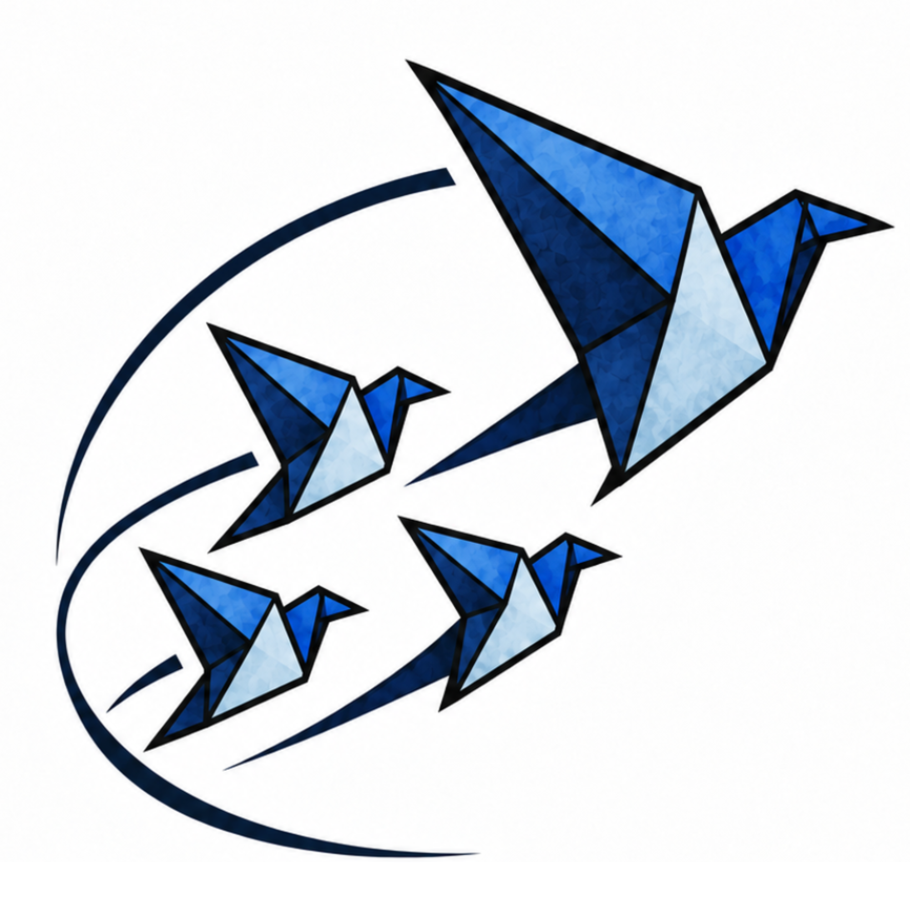

<div align="center">

<!-- TODO(release): Replace with the final Agency logo. -->


# Agency

**See. Understand. Control.**

**Live debugging and systems profiling for AI agents.**

[Getting started](docs/getting-started.md) · [Documentation](docs/api/index.md) · [Examples](examples/README.md) · [Contributing](CONTRIBUTING.md)

</div>

As AI agents execute longer workflows, invoke tools, and run concurrently, understanding what they are doing—and why they are slow or stuck—gets harder. Model traces alone do not explain process activity, resource contention, or critical-path delays.

**Agency 0.1** is an open-source platform for observing, debugging, profiling, and controlling agent execution. It connects model requests, tool calls, and system-level activity in one environment, so you can investigate a run while it happens and analyze what happened afterward.

<!-- TODO(release): Replace with an actual product recording. -->

## What you can do with Agency

### Live Trajectory — see what your agents are doing

Follow agent execution as it happens. Inspect model requests, tool calls, tool outputs, failures, and waits across agents, without reconstructing the run from scattered logs. Pause, resume, or cancel supported executions through Agency's controls.

The same view provides a historical execution record when a run finishes.

<!-- TODO(release): Record multiple agents executing, inspecting an invocation, and exercising a supported control. -->

### Critical Path Profiler — find what determines completion time

See how work and dependencies unfold on a shared wall-clock axis, with separate lanes for agents and their system activity. Trace the sequence of work that governs total execution time, distinguish useful overlap from idle time, and investigate long model calls, tools, and scheduling delays.

Critical-path analysis is primarily a **post-run** workflow: use Live Trajectory while agents are running, then examine the recorded execution to understand its bottlenecks.

<!-- TODO(release): Show agent lanes, dependencies, critical path, and time-axis zoom. -->

### Detailed Profiler — investigate where time and resources go

Drill into recorded evidence across **LLM requests, tool calls, and systems**: durations, errors and retries, reported token usage, process activity, CPU, memory, I/O, and optional GPU metrics. Use linked execution records to move from a high-level symptom to the underlying event or resource trace.

Agency distinguishes recorded measurements from interpretations. Missing metrics are shown as unavailable rather than estimated.

<!-- TODO(release): Show LLM, tool, and systems profiling views. -->

### Compare Runs — understand what changed

Compare completed runs side by side: execution trajectories, model and tool activity, elapsed time, recorded resource usage, failures, and outcomes. Inspect where paths diverge and which observed measurements differ.

Comparisons use **historical run data only**. Agency does not invent missing data or assign an unsupported cause to a difference.

<!-- TODO(release): Show selection of two historical runs and trajectory/metrics comparison. -->

## Underneath your agent stack

Agency provides an execution environment and a Python interface for running agent workloads. Your application still owns its workflow logic—whether that is a Python loop, a state machine, or a supervisor/worker system. Agency provides supported harness and model integrations, execution controls, and telemetry.


[Editable architecture diagram](docs/assets/agency-runtime.mmd)

| Layer | Supported options |
| --- | --- |
| Agent harnesses | Native, Claude Code, Codex, OpenCode, Grok, Kimi |
| Model backends | OpenAI Chat Completions / Responses, Anthropic, Amazon Bedrock, and tool-capable OpenAI-compatible endpoints (including vLLM) |
| Environment | Linux sandboxes using Docker or Podman; configurable resources and mounts |

Harness and model compatibility depends on model capabilities, configuration, and external CLI versions. External harness CLIs must be installed separately. See [configuration and requirements](docs/guides/configuration.md).

> **Experimental: existing coding-agent sessions.** Agency's integration with the Claude Code and Codex CLIs on Linux is experimental. Some Agency features—including parts of profiling, interception, and interactive control—may not be available for those sessions. The supported Python-orchestrated workflows provide the more complete Agency experience; consult the current documentation before relying on a specific capability.

## Getting started

### Requirements

- Linux x86-64 and Python 3.12+
- Git and [uv](https://docs.astral.sh/uv/getting-started/installation/)
- A local Docker or Podman engine (`docker info` or `podman info`)
- An API key for your configured model provider

### Install and run

```bash
git clone https://github.com/agency-project/agency.git
cd agency
uv sync --locked --python 3.12

export OPENAI_API_KEY="your-api-key"
export OPENAI_MODEL="gpt-6-luna"
uv run python examples/quickstart.py
```

This example runs Agency's native harness with OpenAI Chat Completions and function tools. The model must accept `reasoning_effort="none"`; change the configured model if necessary. Model API usage may incur charges. The example reads your exported environment variables; it does not automatically load `.env`.

First startup needs network access to pull a sandbox image and install dependencies. The quickstart does not require a GPU, ZFS, or CRIU; GPU passthrough is disabled. For troubleshooting, see the [getting started guide](docs/getting-started.md).

### Run an agent in Python

Agency's Python API lets you choose the harness and model backend independently. This is the workload used in [`examples/quickstart.py`](examples/quickstart.py):

```python
import os
from pathlib import Path

from agency import Agent, agdata, agskill
from agency.configs.agconfig import agconfig, llmconfig, resourcesconfig, sandboxconfig

cfg = agconfig(
    llmconfig(
        provider="openai",
        base_url="https://api.openai.com/v1",
        model=os.environ.get("OPENAI_MODEL", "gpt-6-luna"),
        api_key=os.environ["OPENAI_API_KEY"],
        reasoning_effort="none",
        max_completion_tokens=4096,
    ),
    sandboxconfig(gpu_passthrough=False),
    resourcesconfig(idle_cpus=1),
)

task = agskill(
    name="code_and_test",
    prompt="Complete the request in /workspace. Run the code, then summarize the result.",
    input_schema=agdata(request=str),
    output_schema=agdata(summary=str),
)

worker = Agent("coder", agconfig=cfg, harness="native")
result = worker.run(
    task,
    agdata(request="Write sum_even(numbers) in Python and run assertions for empty and mixed lists."),
)
result.wait()
print(result.summary)
print(f"Run directory: {Path(worker.data_logger.db_path).parent.parent}")
```

Save as `first_agent.py` and run `uv run python first_agent.py` from the checkout. `run()` returns a pending result; call `wait()` before reading the output. On failure, inspect `result.to_dict()` for `error`. The code executes in `/workspace` inside the sandbox, and the printed host directory preserves run logs after sandbox cleanup.

### Open the dashboard and profiler

```bash
AGENCY_PROFILE=1 AGENCY_PROFILE_SCOPE=workload \
  uv run python examples/quickstart.py --webui
```

Open the [dashboard](http://localhost:7860/) to follow execution and the [profiler](http://localhost:7860/profiler) to inspect model, tool, and systems data. Recorded traces remain available for analysis after the run. The web server binds to `0.0.0.0`; avoid exposing it to untrusted networks without appropriate access controls.

See the [profiling guide](docs/guides/profiling.md) and [profiler views reference](docs/guides/profiling/views.md) for collection scope, available data, and limitations.

## Documentation

- [Getting started](docs/getting-started.md) — install Agency and run an example.
- [Configuration](docs/guides/configuration.md) — harnesses, providers, and environments.
- [Profiling](docs/guides/profiling.md) — collect traces and interpret execution evidence.
- [Examples](examples/README.md) — agent workflows, tools, context, and files.
- [API reference](docs/api/index.md) — Python interfaces and current contracts.
- [Architecture](docs/architecture/index.md) — execution runtime and system design.

## Contributing

Agency is open source and welcomes bug reports, feedback, and contributions. Read [CONTRIBUTING.md](CONTRIBUTING.md) for development setup and testing instructions.

<!-- RELEASE ASSET CHECKLIST (temporary paths above):
- docs/assets/agency-logo-placeholder.png
- docs/assets/agency-overview.gif
- docs/assets/agency-live-trajectory.gif
- docs/assets/agency-critical-path.gif
- docs/assets/agency-detailed-profiler.gif
- docs/assets/agency-compare-runs.gif
Replace these with real assets and remove this checklist before release.
-->
