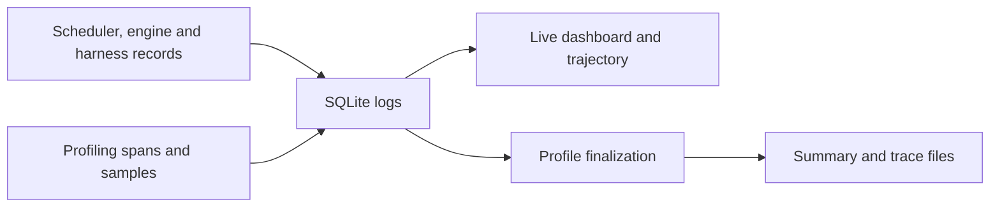

# observability — records, profiling and views

`agency/observability/` records execution and turns those records into timelines, resource summaries and interactive views. Its data describes what happened; authoritative request state stays in the [orchestrator](orchestrator.md), and filesystem state stays in [sandbox](sandbox.md).

## Internal responsibilities

| Source area | Responsibility |
| --- | --- |
| [agdatalogger.py](../../agency/observability/agdatalogger.py) | SQLite persistence for events, spans, snapshots, model exchanges and stream deltas. |
| [profiler/](../../agency/observability/profiler/agprof.py) | Profiling sessions, spans, automatic Python intervals, CPU/wait accounting and resource sampling. |
| [profiler/agprof_trace.py](../../agency/observability/profiler/agprof_trace.py) | Trace export and summary generation. |
| [agwebui/](../../agency/observability/agwebui/__init__.py) | Web UI lifecycle, workload wrapping and live control relay. |
| [agwebui/server.py](../../agency/observability/agwebui/server.py) and [trajectory.py](../../agency/observability/agwebui/trajectory.py) | Read saved records and assemble dashboard/trajectory views. |

## Collection to presentation

Each agent has a SQLite logger for frequent execution records; the process-wide logger records scheduler and shared-resource events. Model exchanges preserve messages and streamed deltas, while runtime events and spans carry request, agent and sandbox identities.

Writes are batched. The UI parent periodically flushes loggers, and the server subprocess reads committed records. Live dashboards and trajectory views use this database path. Completed raw traces have a separate profiling-session finalization boundary.

## Session ownership

`agprof` maintains one active profiling session. Explicit session boundaries or workload/process wrappers own start and stop. Stopping sampling and closing open intervals allows summary and trace generation. Background work must be joined inside a workload boundary if its execution should be included. Host spans, sandbox reports and process/cgroup counters provide different views of the same run.

The Web UI relays controls to live Python agents in the parent process; reading a saved database alone does not restore those agents. Logs are observation storage rather than a request recovery journal, and a crash can lose unflushed rows.

## Measurement limits

Wall time includes provider latency, startup and idle waits. Nested spans overlap, so adding parent and child durations double-counts time. Counters are sampled, and missing usage or resource data should remain unavailable. Reconstructed activity labels and harness completion do not establish task correctness.

Use the [profiling guide](../guides/profiling.md) for viewing runs and [runtime reference](../api/runtime.md) for session APIs. Historical benchmark observations are retained in the [measurement archive](../archive/measurements.md), separately from the package design.

## Profiler → Critical Path

Open the **Critical Path** category in the Profiler view, or use
`/profiler?run=live&view=profiler&profiler=critical`. Existing Trajectory,
Timeline, and profiler categories remain available.

The diagram uses time-aligned event nodes and directional dependency arrows,
with LLM, Tool, and System bands for each agent. A circle is an operation start;
a diamond is its observed end. An open boundary shows an ongoing operation,
not a recorded completion. Select a node or arrow to inspect IDs, timing,
source evidence, profiling metrics, and missing observations. Double-click a
node to expand its operation. Agent filtering, fit, zoom, scrolling, live lock,
freeze, and replay use the existing profiler navigation and transport.

Model exchange identity connects request and response boundaries. Complete
canonical prompt/response blocks supply content hashes and model tool IDs for
response → tool, tool result → consuming request, sequential continuation, and
parallel joins. Reused IDs are scoped to their issuing exchange and recorded
prompt history. When a saved profiler span has a call label, its sibling SQLite
exchange supplies complete identity evidence even when span previews are
truncated. Standalone traces fall back to their captured content.

Solid arrows are verified dependencies. Dotted history references are
provenance and can be shown separately. Dashed inferred relationships (such as
a possible retry with the same prompt) are opt-in and do not enter the path
calculation. Tool issuance and result-consumption bounds can be displayed
without permission hooks; they do not establish tool execution duration.

The DAG calculation highlights the longest **observed dependency chain** and
reports measured work separately from unexplained elapsed waits. A wait after
the latest observed prerequisite contributes to that chain's elapsed time, but
its cause remains explicitly unknown and its segment is dashed. A short branch
waiting for a known sibling is join slack, not an unexplained gap. Slack is
conditional on the recorded graph; missing dependencies can hide constraints.
Concurrent operation-time totals overlap and are not execution wall time.

Coverage is always qualified as partial. Missing results, truncated standalone
history, ambiguous IDs, ongoing operations, compaction, and unrecorded
completion dependencies cannot establish a complete system-wide critical path.
Existing scheduler/system calls are shown where captured. Explicit process
ownership can appear as provenance; process parentage and timestamp overlap
never establish blocking dependencies. Native Tool → Process attribution is
not supplied by this release.
