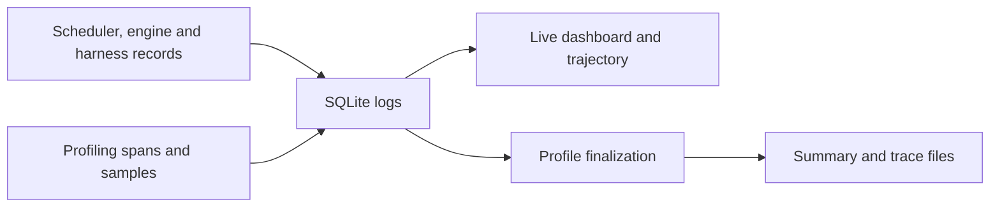

# observability — records, profiling and views

`agency/observability/` records execution and turns those records into timelines, resource summaries and interactive views. Its data describes what happened; authoritative request state stays in the [orchestrator](orchestrator.md), and filesystem state stays in [sandbox](sandbox.md).

## Internal responsibilities

| Source area | Responsibility |
| --- | --- |
| [agdatalogger.py](../../agency/observability/agdatalogger.py) | SQLite persistence for events, spans, snapshots, model exchanges and stream deltas. |
| [profiler/](../../agency/observability/profiler/agprof.py) | Profiling sessions, spans, automatic Python intervals, CPU/wait accounting and resource sampling. |
| [profiler/agprof_trace.py](../../agency/observability/profiler/agprof_trace.py) | Trace export and summary generation. |
| [agwebui/](../../agency/observability/agwebui/__init__.py) | Web UI lifecycle, workload wrapping and live control relay. |
| [agwebui/server.py](../../agency/observability/agwebui/server.py) and [trajectory.py](../../agency/observability/agwebui/trajectory.py) | Read saved records and assemble dashboard/trajectory views. |

## Collection to presentation

Each agent has a SQLite logger for frequent execution records; the process-wide logger records scheduler and shared-resource events. Model exchanges preserve messages and streamed deltas, while runtime events and spans carry request, agent and sandbox identities.

Writes are batched. The UI parent periodically flushes loggers, and the server subprocess reads committed records. Live dashboards and trajectory views use this database path. Completed raw traces have a separate profiling-session finalization boundary.

## Session ownership

`agprof` maintains one active profiling session. Explicit session boundaries or workload/process wrappers own start and stop. Stopping sampling and closing open intervals allows summary and trace generation. Background work must be joined inside a workload boundary if its execution should be included. Host spans, sandbox reports and process/cgroup counters provide different views of the same run.

The Web UI relays controls to live Python agents in the parent process; reading a saved database alone does not restore those agents. Logs are observation storage rather than a request recovery journal, and a crash can lose unflushed rows.

## Measurement limits

Wall time includes provider latency, startup and idle waits. Nested spans overlap, so adding parent and child durations double-counts time. Counters are sampled, and missing usage or resource data should remain unavailable. Reconstructed activity labels and harness completion do not establish task correctness.

Use the [profiling guide](../guides/profiling.md) for viewing runs and [runtime reference](../api/runtime.md) for session APIs. Historical benchmark observations are retained in the [measurement archive](../archive/measurements.md), separately from the package design.

## Critical Path

Critical Path is main tab 3, after Execution Trajectory and Profiler. The retired
Timeline URL redirects to Critical Path. Legacy Profiler category links also
remain supported. Perfetto remains the detailed kernel/system timeline.

For an active execution, Critical Path stays empty until the final run boundary
is recorded. The backend defers graph construction until completion and any
database backlog has been read. Completed recordings retain Critical Path review
and replay. Live revision history is limited to 512 patches and a conservative
64 MiB heap budget; clients outside retained history recover a current snapshot.

The unified graph has three primary types: purple rounded LLM requests, blue
tool rectangles, and teal Linux-process hexagons. Timestamp anchors and thin
interval bars use the recorded clock. Compact, readable cards are independent
of their duration; an unknown duration never becomes measured work. Y uses a
deterministic interval pack near connected operations. Retained lanes remain
stable through recorded replay; there are no category bands or
force simulation. Missing timestamps and issuance bounds remain qualified.

The initial view shows the known critical operation chain, with highlighting
on. Critical outlines/arrows are gold; expanded noncritical branches are dimmed.
Toggle highlighting or switch to all LLM/tools. Open parallel branches and
verified process relationships explicitly. History provenance and inferred
relationships remain opt-in. Only verified blocking edges enter path analysis;
ancestry/ownership are nonblocking provenance. Unknown elapsed gaps annotate the
original edge and inspector evidence. Filtering never invents connecting edges.
The full raw analysis is retained; the primary operation path reuses the same
backend algorithm over LLM/tool/process evidence.

Ctrl/Cmd-wheel and pinch zoom around the cursor's timestamp. Empty-space drag
pans both axes; manual navigation disables Live. Buttons provide incremental
zoom, Fit, Reset, and Live. A ruler stays visible while panning vertically.
Semantic overview groups nearby labels with explicit member inspection. Fit can
fold distant lanes into overview groups, without changing timestamps or source
identities. Detailed zoom adds labels/actor information; font sizes remain
readable rather than scaling with time. Paged disclosure, viewport culling,
layout caching, and an expansion bound keep large recordings manageable.

Syscalls never become primary nodes. Systems profiler aggregates them by name
and exposes counts, untimed observations and summed time (which may overlap).
Successful execve with captured PID/path supplies a process-image observation;
failed execve does not. Syscall latency/return values are never process runtime
or exit status. An observation's lifecycle remains unknown. Explicit ownership,
parent-action identity or captured PPID with a unique actor-scoped parent can
supply provenance; ambiguous/reused PIDs stay unlinked. Timestamp overlap never
establishes ownership, and namespace PIDs are not matched to unrelated host
resource counters. Unattributed processes have a separate disclosure view;
disconnected images of the same executable/actor can be grouped without
claiming parentage. Inspect PID, PPID, executable, arguments, lifecycle and only
captured CPU/RSS/I/O/exit metrics. Missing fields say unavailable.

Model exchange/content identity, scoped model tool IDs, saved SQLite enrichment,
permission-hook correlation, and the existing live/replay transport continue to
supply dependencies. Inspect nodes or arrows for original IDs, metrics,
relationships and immutable evidence. Bounded graph previews retain model names
and command snippets after calls leave the live window; the existing source
payload viewer retrieves full captured arguments, requests and responses.

The summary shows execution duration, known critical contribution, LLM/tool
interval unions, wall time outside their combined measured intervals, and
partial coverage. Unions avoid double-counting concurrent calls within each
category; LLM and tool coverage may overlap and must not be added. Unattributed
wall time can include other work and missing observations. Missing dependencies,
process lifecycle gaps and incomplete histories prevent claiming a complete
system-wide critical path.
